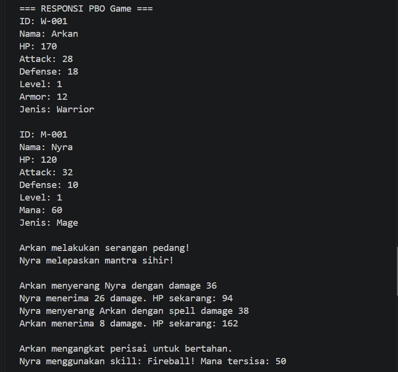
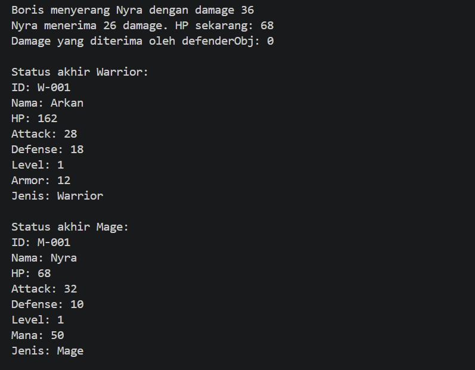
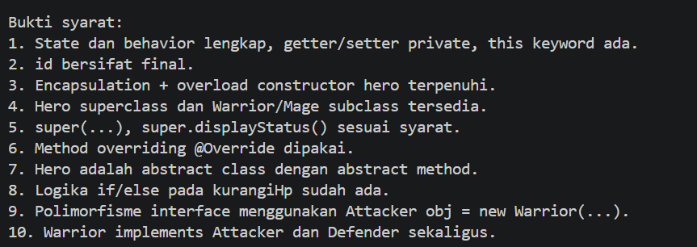

# Responsi Akhir PBO — Game

## Identitas Mahasiswa

- **Nama:** [Bagas Budi Prasetyo]
- **NIM:** [H1D025040]
- Tema berdasarkan digit terakhir NIM: Game 

## Compile dan Menjalankan Program

### Terminal (PowerShell)

Buka terminal pada folder utama proyek, lalu jalankan:

```powershell
New-Item -ItemType Directory -Force out | Out-Null
$sources = Get-ChildItem -Recurse .\src\main\java -Filter *.java | ForEach-Object FullName
javac -d .\out $sources
java -cp .\out responsipbo.Main
```

Pastikan JDK sudah terpasang dan perintah `javac` serta `java` tersedia di
`PATH`. File hasil kompilasi akan disimpan di folder `out`.

### IntelliJ IDEA

1. Pilih **File > Open**, lalu pilih folder utama proyek.
2. Jika diminta, pilih **Trust Project**.
3. Pastikan **Project SDK** menggunakan JDK (misalnya JDK 17 atau lebih baru):
   buka **File > Project Structure > Project**, lalu pilih SDK.
4. Pada **Project Structure > Modules**, pastikan `src\main\java` ditandai
   sebagai **Sources**. Jika belum, klik kanan folder tersebut di panel Project
   dan pilih **Mark Directory as > Sources Root**.
5. Buka `src\main\java\responsipbo\Main.java`, lalu klik ikon run di samping
   `main` atau klik kanan file dan pilih **Run 'Main.main()'**.

### Eclipse IDE

1. Pilih **File > Import > General > Existing Projects into Workspace**.
2. Pilih folder utama proyek sebagai **root directory**, pilih proyek yang
   ditemukan, lalu klik **Finish**.
3. Jika folder proyek belum terdeteksi sebagai proyek Java, gunakan **File >
   New > Java Project**, beri nama proyek, lalu atur **Location** ke folder
   proyek ini. Pastikan `src\main\java` menjadi source folder melalui
   **Project > Properties > Java Build Path > Source**.
4. Atur JDK pada **Project > Properties > Java Build Path > Libraries**.
5. Di Package Explorer, buka `responsipbo`, klik kanan `Main.java`, lalu pilih
   **Run As > Java Application**.

## Screenshot Luaran Program



